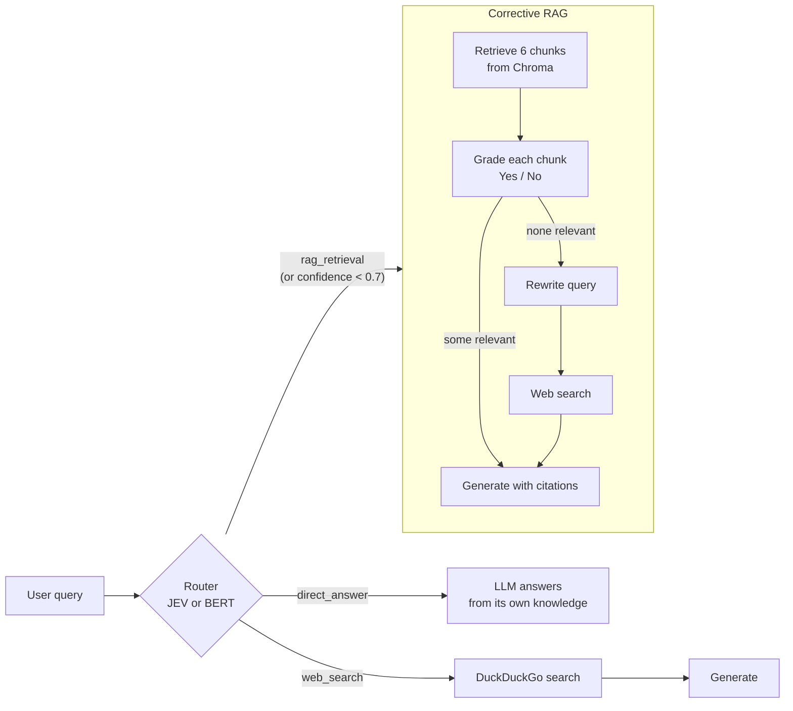

# Adaptive JEV RAG

An adaptive retrieval-augmented generation (RAG) system over 10 RAG research papers. A router decides, per query,
whether to answer directly, search the web, or run a corrective RAG pipeline over the papers. The project compares two
routers: **JEV**, a 4B LLM used as a zero-shot classifier, and a **fine-tuned BERT** classifier. It also evaluates the
RAG part with **RAGAS**.

## How it works



| Route | When | What runs |
|---|---|---|
| `direct_answer` | Greetings, common facts, general definitions, simple math | One LLM call with `SYSTEM_PROMPT` |
| `web_search` | News, prices, recent events, current versions | DuckDuckGo (5 results), then one generation call |
| `rag_retrieval` | Anything about the papers in the knowledge base, or deep analysis of them | Retrieve, grade, generate; falls back to rewrite and web search if no chunk is relevant |

If the router's confidence is below `THRESHOLD = 0.7`, the query goes to `rag_retrieval`, the most capable route.

- **LLM:** `openai/gpt-oss-120b` on Groq (generation, grading, query rewriting)
- **Embeddings:** `sentence-transformers/all-mpnet-base-v2`; **vector store:** Chroma (chunks of 1000 characters, 150 overlap)
- **JEV router:** `Qwen/Qwen3.5-4B` through [`open-alternative-jev`](https://github.com/ikermoel/open-alternative-jev) (`so1`).
  It never generates text: it reads the next-token probabilities of the option letters A/B/C and returns a choice with a confidence.
- **BERT router:** `bert-base-uncased` fine-tuned on 150 labeled routing queries

## Repository layout

| Path | Contents |
|---|---|
| [adaptive.ipynb](adaptive.ipynb) | Full pipeline with the **JEV** router, plus the JEV router benchmark and the RAGAS evaluation |
| [adaptive_bert.ipynb](adaptive_bert.ipynb) | The same pipeline with the **BERT** router, its benchmark and the JEV-vs-BERT comparison table |
| [jev_optimizations.ipynb](jev_optimizations.ipynb) | Speed-ups for the 4B JEV router (prefix caching, batching, 4-bit) benchmarked against BERT |
| [eval/router_dataset.json](eval/router_dataset.json) | Routing queries: 150 for training (50 per route), 30 held-out test queries (10 per route) |
| [eval/ragas_testset.json](eval/ragas_testset.json) | 10 RAGAS questions, one per paper, with reference answers written from the papers |
| [results/](results/) | Every number in this README, as JSON/CSV (see [Result files](#result-files)) |
| [pdf/](pdf/) | The 10 papers in the knowledge base |
| [test.py](test.py) | Standalone script that tests the JEV router on its own |

The knowledge base: DPR (2004.04906), RAG (2005.11401), HyDE (2212.10496), *When Not to Trust Language Models* / PopQA
(2212.10511), FLARE (2305.06983), Self-RAG (2310.11511), the RAG survey (2312.10997), CRAG (2401.15884),
RAPTOR (2401.18059) and Adaptive-RAG (2403.14403).

## Setup and running

```powershell
uv sync                      # installs everything, including the CUDA 13.0 build of PyTorch
```

Create a `.env` file with your Groq key (and optionally LangSmith, to trace the router calls):

```
GROQ_API_KEY=...
LANGSMITH_API_KEY=...        # optional
LANGSMITH_TRACING=true       # optional: the router functions are decorated with @traceable
```

Run [adaptive.ipynb](adaptive.ipynb) top to bottom, then [adaptive_bert.ipynb](adaptive_bert.ipynb). The comparison
table at the end of the BERT notebook reads `results/router_jev.json`, which the JEV notebook writes.

- **GPU:** JEV needs about 8.1 GB of GPU memory. The embedding model runs on the CPU so JEV fits on a 12 GB card without
  being offloaded. Load the notebook in a fresh kernel: loading JEV twice in one kernel does not fit.
- **Groq free tier:** `gpt-oss-120b` allows 8,000 tokens per minute and **200,000 tokens per day**. One full run of both
  notebooks uses roughly that daily allowance (the 10 RAGAS questions alone use 68,038 tokens). The RAGAS judge
  (`gpt-oss-20b`) has its own, separate limits.

## Results

Measured on an RTX 5070 Ti Laptop GPU (12 GB), Windows 11, Python 3.14.7, torch 2.14.1+cu130.

### Router: JEV vs fine-tuned BERT

Both routers were run on the same 30 held-out queries (10 per route), one query at a time, after 3 warm-up calls.

| | JEV (Qwen3.5-4B, zero-shot) | BERT (bert-base-uncased, fine-tuned) |
|---|---|---|
| **Accuracy** | **100.0 %** (30/30) | **96.7 %** (29/30) |
| Accuracy after the 0.7 confidence fallback | 100.0 % | 96.7 % |
| Macro F1 | 1.000 | 0.967 |
| F1: direct_answer / web_search / rag_retrieval | 1.000 / 1.000 / 1.000 | 0.952 / 1.000 / 0.947 |
| Queries below the 0.7 threshold | 0 | 0 |
| Mean confidence (lowest) | 0.9985 (0.9769) | 0.9961 (0.9825) |
| **Mean latency** | **174.8 ms** | **13.8 ms** |
| Median latency | 176.5 ms | 9.7 ms |
| p95 latency | 215.7 ms | 29.3 ms |
| Min / max latency | 139.0 / 231.3 ms | 4.1 / 29.8 ms |
| Total for 30 queries | 5.25 s | 0.41 s |
| **Input tokens per query** | **198.1** (193–207) | **12.3** (6–20) |
| Total input tokens (30 queries) | 5,943 | 368 |
| Output tokens per query | 0 | 0 |
| Parameters | 4,205.8 M | 109.5 M |
| Peak GPU memory | 8,118 MB | 1,320 MB |
| Load time | 19.7 s | 4.1 s |
| Training time | none | 5.2 s (8 epochs) |
| Labeled training examples | 0 | 150 |

Confusion matrices (rows = true route, columns = predicted; order: direct_answer, web_search, rag_retrieval):

```
JEV                     BERT
[10,  0,  0]            [10,  0,  0]
[ 0, 10,  0]            [ 0, 10,  0]
[ 0,  0, 10]            [ 1,  0,  9]
```

BERT's only mistake was **"What is HyDE?"**, which it sent to `direct_answer` with 0.99 confidence. The training set
taught it that short "What is X?" questions are general definitions, except for the few paper methods it saw ("What is
RAPTOR?", "What is CRAG?"). HyDE was not one of them.

**What the numbers say**

- **BERT is far cheaper.** Compared with JEV, it is 12.7× faster on average (18× at the median), reads 16× fewer
  tokens, has 38× fewer parameters and needs 6.1× less GPU memory.
- **JEV is slightly more accurate and needs no labeled data.** It got the one query BERT missed. Changing JEV's behavior
  means editing the route descriptions; changing BERT's means relabeling data and retraining (5 seconds).
- **The router is a small part of the total time.** A RAG-route answer takes 39 s on average on the free tier (7.2 s
  without rate-limit waits), so JEV's 175 ms is under 3 % of an unthrottled RAG answer. The bigger cost of JEV is the
  8 GB of GPU memory it holds.
- **Neither router signals uncertainty.** Both were over 97 % confident on every query, including BERT's wrong answer,
  so the 0.7 fallback never fired.

**Caveats**

- 30 test queries is small: one query is 3.3 percentage points.
- JEV's route descriptions name the methods in the knowledge base (DPR, RAG, HyDE, FLARE, Self-RAG, CRAG, RAPTOR,
  Adaptive-RAG), and several test queries mention those names. That gives JEV the same kind of domain knowledge BERT
  gets from its training data, and it is part of why JEV scored 100 %.
- The test queries were written by hand, like the training queries, so they are cleaner than real user traffic.

### Making JEV cheaper

[jev_optimizations.ipynb](jev_optimizations.ipynb) keeps the same Qwen3.5-4B model and tries three ways to close the
gap with BERT, on the same 30 test queries, the same prompt and the same timing method:

- **Prefix caching:** the instruction and route descriptions are the same for every query, so their KV cache is
  computed once and reused. Only the query and the answer options are processed per call. The token sequence the model
  sees is unchanged: all 30 choices matched the normal path and probabilities differed by at most 0.003.
- **Batching:** all 30 queries in one `decide_many` call. Latency is total time / 30.
- **4-bit quantization:** NF4 through bitsandbytes, with bfloat16 compute.

Both the bf16 and the 4-bit model were run in all three call modes, so 4-bit is also tested combined with prefix
caching and with batching. "After fallback" applies the pipeline's rule that a confidence below 0.7 sends the query to
`rag_retrieval`.

| Router | Mode | Accuracy | After 0.7 fallback | Mean latency | Median | p95 | Tokens per query (read / computed) | Weights on GPU | Peak GPU |
|---|---|---|---|---|---|---|---|---|---|
| Qwen3.5-4B bf16 | full | 100 % | 100 % | 97.1 ms | 96.7 ms | 109.8 ms | 198 / 198 | 8,022 MB | 8,118 MB |
| | prefix-cached | 100 % | 100 % | 91.2 ms | 81.6 ms | 131.0 ms | 198 / 46 | | 8,198 MB |
| | batched | 100 % | 100 % | 64.1 ms | | | 198 / 198 | | 10,046 MB |
| **Qwen3.5-4B 4-bit** | full | 100 % | 100 % | 115.3 ms | 113.7 ms | 132.4 ms | 198 / 198 | **3,203 MB** | **3,268 MB** |
| | prefix-cached | 100 % | 100 % | 129.6 ms | 132.1 ms | 144.8 ms | 198 / 46 | | 3,352 MB |
| | batched | 100 % | 100 % | 66.0 ms | | | 198 / 198 | | 5,202 MB |
| **BERT (fine-tuned)** | full | **96.7 %** | **96.7 %** | **13.8 ms** | **9.7 ms** | **29.3 ms** | **12 / 12** | | **1,320 MB** |

No query fell below the 0.7 threshold in any setup. Mean confidence was 0.9985 for bf16 and 0.9996 for 4-bit (lowest
0.9739 and 0.9960). Load time: 24.3 s for bf16, 18.0 s for 4-bit.

**Run-to-run variation is large on this laptop GPU.** The same setup (4B bf16, full prompt) measured 175 ms per query in
`adaptive.ipynb`, 156 ms in an earlier run of this notebook and 97 ms in the run above, because the GPU's clock speed
depends on power and temperature. Treat latency differences under about 20 % as noise. The batched result was the most
stable: 64–66 ms per query in every run.

**What each technique did**

- **4-bit is the clear win for memory.** The model needs 2.5× less GPU memory (3.3 GB peak instead of 8.1 GB) with the
  same 100 % accuracy and slightly higher confidence. It is somewhat slower per query (115 vs 97 ms here, 195 vs 156 ms
  in the earlier run) because the weights are dequantized on every call.
- **Batching is the only large latency win**, 64–66 ms per query against 97–156 ms one at a time. It only helps when
  many queries arrive at once. A chat app routes one query at a time, where it does not apply. Batching 30 queries also
  raises peak memory (10.0 GB for bf16, 5.2 GB for 4-bit).
- **Prefix caching cuts compute, not time.** It skips 77 % of the prompt tokens (198 → 46), but the latency change
  (−6 % for bf16, +12 % for 4-bit) is within run-to-run noise. With one query at a time the GPU is not limited by token
  count, so processing fewer tokens barely matters.
- **Hidden cost: slow fallback kernels.** transformers warns that Qwen3.5's linear-attention layers run on a slow
  reference PyTorch implementation because `flash-linear-attention` and `causal-conv1d` are not installed. Both need
  Triton or a CUDA build, which is hard on Windows. On Linux they would likely make every setup above faster.

**Verdict:** no 4B setup beats BERT. Per query, the fastest 4B setup (prefix-cached bf16, 91 ms) is still 6.6× slower
than BERT and reads 16× more tokens (3.7× more even counting only the uncached ones). Batched, it is 4.6× slower. The
best JEV setup for this pipeline is **Qwen3.5-4B in 4-bit**: the same 100 % accuracy with 60 % less GPU memory, at the
cost of about 20 % more latency per query. Its memory is still 2.5× BERT's.

### RAGAS: the RAG part

10 questions, one per paper, each run through the corrective RAG graph. RAGAS scored each answer against the chunks the
generator actually saw.

- **Generator:** `openai/gpt-oss-120b`; **judge:** `openai/gpt-oss-20b` (a different model, so the pipeline does not grade itself)
- **Judge embeddings** (for answer relevancy): `all-mpnet-base-v2`

| Metric | What it measures | Mean | Lowest |
|---|---|---|---|
| **Faithfulness** | Share of the answer's claims supported by the retrieved chunks | **0.901** | 0.455 |
| **Answer relevancy** | How well the answer addresses the question | **0.864** | 0.708 |
| **Context precision** | Whether the retrieved chunks are relevant, and relevant ones ranked first | **0.652** | 0.000 |
| **Context recall** | How much of the reference answer the retrieved chunks cover | **0.775** | 0.000 |

Faithfulness is averaged over 9 questions: the judge failed to score the RAG survey answer.

| Paper | Faithfulness | Answer relevancy | Context precision | Context recall | Chunks kept (of 6) | Latency | Groq tokens |
|---|---|---|---|---|---|---|---|
| DPR | 0.944 | 0.918 | 1.000 | 1.000 | 4 | 7.2 s | 7,498 |
| RAG | 0.850 | 0.870 | 1.000 | 1.000 | 1 | 30.6 s | 5,535 |
| HyDE | 0.929 | 0.745 | 0.679 | 1.000 | 5 | 43.4 s | 7,424 |
| PopQA (*When Not to Trust LMs*) | 1.000 | 0.708 | 0.700 | 1.000 | 5 | 58.4 s | 8,494 |
| FLARE | 1.000 | 0.803 | 0.833 | 0.500 | 5 | 49.4 s | 7,342 |
| Self-RAG | 1.000 | 0.872 | 0.806 | 1.000 | 5 | 46.6 s | 6,998 |
| RAG survey | not scored | 0.996 | 0.500 | 1.000 | 2 | 37.1 s | 5,773 |
| CRAG | 0.455 | 0.833 | 0.500 | 0.000 | 3 | 38.3 s | 6,075 |
| RAPTOR | 0.929 | 0.981 | 0.000 | 0.250 | 1 | 37.3 s | 5,741 |
| Adaptive-RAG | 1.000 | 0.909 | 0.500 | 1.000 | 4 | 42.5 s | 7,158 |

**Pipeline cost for the 10 questions**

| | Value |
|---|---|
| Groq tokens | 68,038 total: 51,194 input, 16,844 output (output includes gpt-oss reasoning tokens) |
| Tokens per question | 6,804 mean (5,535–8,494) |
| Latency per question | 39.1 s mean, 40.4 s median, 58.4 s max |
| Latency without rate-limit waits | 7.2 s (the first question, which ran with a full per-minute allowance) |
| Chunks kept by the grader | 3.5 of 6 on average |
| Web fallbacks | 0 of 10 |

The RAGAS judging itself took 17.1 minutes and used 151,500 tokens on `gpt-oss-20b` (119,236 input, 32,264 output).

**What the scores say**

- **Answers are mostly faithful and on topic** (0.90 and 0.86), and the pipeline never needed the web for in-domain questions.
- **Retrieval is the weak link.** Context precision (0.65) is the lowest metric, and the two worst questions both failed at retrieval:
  - **RAPTOR:** the grader kept a single chunk about how RAPTOR *searches* its tree at query time, not how it *builds* the
    tree (embedding, Gaussian-mixture clustering, summarization). The answer then described the wrong process.
  - **CRAG:** the 3 kept chunks name the three actions (Correct, Incorrect, Ambiguous) but never say what each one does
    (refine the documents, discard them and search the web, or combine both), or that the evaluator is a fine-tuned T5-large.
    A third kept chunk came from the Self-RAG paper. The generator filled in the missing details from its own knowledge,
    which `GENERATION_PROMPT` forbids; faithfulness (0.455) and context recall (0.0) flag exactly that.
- **The grader is too lenient.** It kept off-topic chunks (the Self-RAG chunk for a CRAG question, the query-time chunk for
  RAPTOR) instead of rejecting them and triggering a rewrite.

Likely improvements: smaller chunks or a reranker for retrieval, a stricter grader prompt, and a final check that refuses
claims not found in the chunks.

## Known issues and workarounds

- **RAGAS on Python 3.14 needed three workarounds**, all documented in the code:
  - **`scikit-network`:** a RAGAS dependency with no Python 3.14 wheel. It is excluded in `pyproject.toml` and only used for synthetic test-set generation.
  - **Vertex AI import:** RAGAS 0.4.3 imports a Vertex AI class that `langchain-community` 0.4 removed. A small stand-in module fixes the import.
  - **`nest_asyncio`:** inside Jupyter, RAGAS relies on `nest_asyncio`, which hangs on Python 3.14. Scoring runs in a worker thread with `allow_nest_asyncio=False` instead.
- **Groq does not accept `n > 1`**, so the judge is wrapped with `bypass_n=True` and answer relevancy asks for its questions one at a time.
- **gpt-oss occasionally skips the tool call** in structured output, so the grader and rewriter retry up to 3 times.
- **The last demo cell of `adaptive_bert.ipynb`** (one full query through the BERT-routed pipeline) hit Groq's daily
  token limit during the recorded run. BERT routed that query correctly (`rag_retrieval`, 0.99); re-run the cell once the
  limit resets.
- **`adaptive.ipynb` was executed in two passes.** The RAGAS scoring cell hung on the first pass (the `nest_asyncio` issue
  above). After the fix, the remaining cells were re-run in a fresh kernel, without repeating three cells that had
  already finished: the 3 test questions, the single pipeline query and the JEV router benchmark. Their outputs, and
  `results/router_jev.json`, come from the first pass.

## Result files

| File | Contents |
|---|---|
| `results/router_jev.json`, `results/router_bert.json` | Router summary (accuracy, F1, confusion matrix, latency, tokens, memory, timings) and one row per test query |
| `results/router_jev_variants.json` | Both 4B setups (bf16, 4-bit) in every call mode from `jev_optimizations.ipynb`, with one row per test query |
| `results/rag_runs.json` | For each RAGAS question: the answer, the chunks used, node path, Groq tokens and latency |
| `results/ragas_scores.csv` | RAGAS scores per question |
| `results/ragas_summary.json` | RAGAS means and minimums, pipeline cost totals and judge usage |

Library versions used: transformers 5.20.2, sentence-transformers 6.1.0, langchain 1.4.6, langchain-core 1.6.12,
langgraph 1.2.16, langchain-groq 1.1.3, langchain-chroma 1.1.0, ragas 0.4.3, ddgs 9.16.0, open-alternative-jev 0.1.0.
